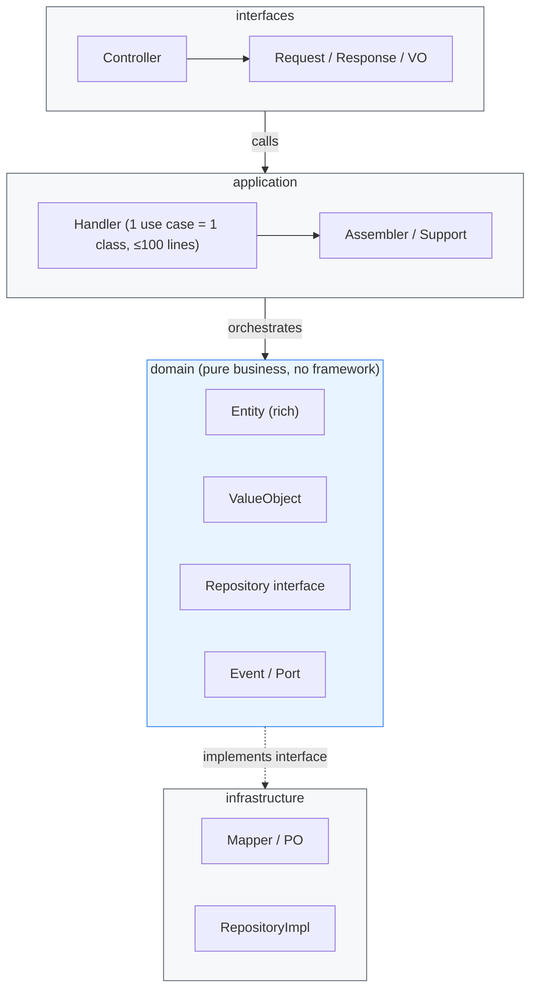

# AI Development Standards × DDD Lite Architecture

A methodology that lets AI consistently produce maintainable, handover-ready, production-grade Java backends. Modular Monolith first, orthogonal to microservices, batteries included.

<p align="center">
  <a href="https://github.com/dayaoakng/AI-Native-JAVA/actions"></a>
  <a href="LICENSE"></a>
  <a href="#"></a>
  <a href="#"></a>
  <a href="#"></a>
  <a href="#"></a>
  <a href="#"></a>
  <a href="#"></a>
  <a href="#"></a>
</p>

> 中文文档见 [README.md](README.md) · See [README.md](README.md) for the Chinese version.

---

## Table of Contents

- [Quick Start](#quick-start)
- [In One Sentence](#in-one-sentence)
- [Architecture Overview](#architecture-overview)
- [The Three-Piece Toolkit](#the-three-piece-toolkit)
- [Key Numbers](#key-numbers)
- [Docs](#docs)
- [Contributing](#contributing)

---

## Quick Start

Two branches — pick one by your JDK:

| Branch | JDK | Notes |
|--------|-----|-------|
| [`main`](https://github.com/dayaoakng/AI-Native-JAVA/tree/main) | **JDK 8** | Aligned with the BOSS production system; starts out of the box (H2 / MySQL) |
| [`jdk17`](https://github.com/dayaoakng/AI-Native-JAVA/tree/jdk17) | **JDK 17** | Same as main, different JDK; CI adapts automatically |

```bash
# Clone (default main, JDK 8)
git clone https://github.com/dayaoakng/AI-Native-JAVA.git

# Or the JDK 17 branch
git clone -b jdk17 https://github.com/dayaoakng/AI-Native-JAVA.git

# Build & test (both branches, from scaffold/)
cd AI-Native-JAVA/scaffold
mvn test

# Run (both branches; embedded H2, no DB install required)
cd demo-modules/demo-partner
mvn spring-boot:run

# Verify
curl -X POST http://localhost:8080/partners \
  -H "Content-Type: application/json" \
  -d '{"code":"P001","name":"Demo Partner"}'
# → {"code":"200","data":{"id":1,"status":0,"statusDesc":"未激活"},...}
```

> Full run / MySQL instructions: [scaffold/README.md](scaffold/README.md).

---

## In One Sentence

> Traditional development: humans write code, AI assists.
> Ours: **AI writes code by the rules, humans review and decide** — because the rules are explicit enough for AI output to be trusted.

## Architecture Overview

We use **DDD Lite**: a **Modular Monolith** architecture that keeps DDD's core value (rich domain model, layering, domain boundaries) while cutting the abstractions that confuse both AI and humans (an aggregate root is just an `Entity`, no `Aggregate` class). It is **orthogonal to microservices** — it governs how code is written *inside* a process, and nests into any architecture.



**One-way dependency**: outer layers depend on inner layers, never the reverse; the domain layer touches no Spring/MyBatis/Redis — portable and independently testable.

## The Three-Piece Toolkit

Controllable AI output doesn't come from "reasoning with the model" — it comes from three *executable* artifacts:

| Piece | Example |
|-------|---------|
| **① Hard rules** | No `service/`; file ≤ 300 lines, Handler ≤ 100 lines, method ≤ 30 lines; entities must live in `domain/entity/` |
| **② Decision tree** | "Domain rule → Entity; use-case orchestration → Handler; persistence → infrastructure" |
| **③ Auto checks** | `scripts/standards/scan-compliance.py` for reports; pre-commit hook (`.githooks/`) + GitHub Action (`.github/workflows/ci.yml`) as gates |

## Key Numbers

| Metric | scaffold (this repo) | Production (BOSS) |
|--------|----------------------|-------------------|
| Business-module Handlers | 2 | **462** |
| Fake Handlers / legacy Service / DomainService / Aggregate | **0** | **all 0** |
| Controller → Handler direct-call rate | **100%** (1/1) | **~100%** |

> Reproducible: `python scripts/standards/metrics.py --root scaffold` produces the same metrics for any DDD Lite codebase. The BOSS numbers are internal measurements (source not open); `scaffold/` is the minimal reproducible sample.

## Docs

| Doc | Content | Audience |
|-----|---------|----------|
| [AI Development Handbook](docs/AI开发手册.md) | Practical rules: layering, naming, responsibilities, quality gates, events, review checklist | Developers / AI assistants |
| [Methodology](docs/AI开发规范方法论.md) | Why AI writes bad code, and our solution | Decision makers |
| [Architecture](docs/架构说明.md) | What DDD Lite is, vs MVC / classic DDD, trade-offs, combining with microservices | Decision makers / Developers |
| [scaffold/](scaffold/) | Runnable skeleton (`mvn spring-boot:run`, H2/MySQL, 9 Spock tests) | Developers |
| [AGENTS.md](AGENTS.md) | Rules entry for AI coding assistants (Claude Code / Cursor) | AI assistants |

---

## Contributing

Issues and PRs welcome — see [CONTRIBUTING.md](CONTRIBUTING.md); code of conduct in [CODE_OF_CONDUCT.md](CODE_OF_CONDUCT.md); changelog in [CHANGELOG.md](CHANGELOG.md).

---

**License**: [MIT](LICENSE) · A production-proven AI development paradigm.
