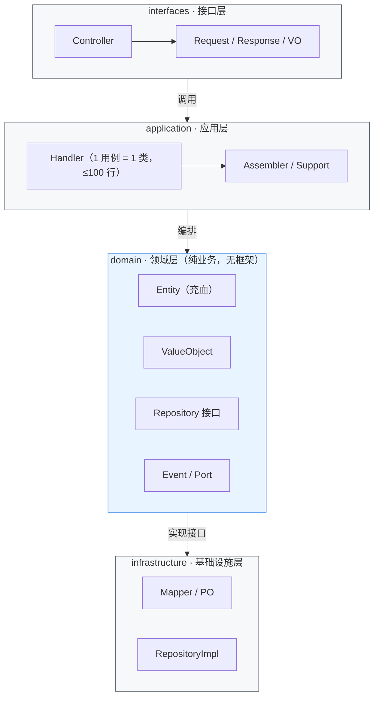
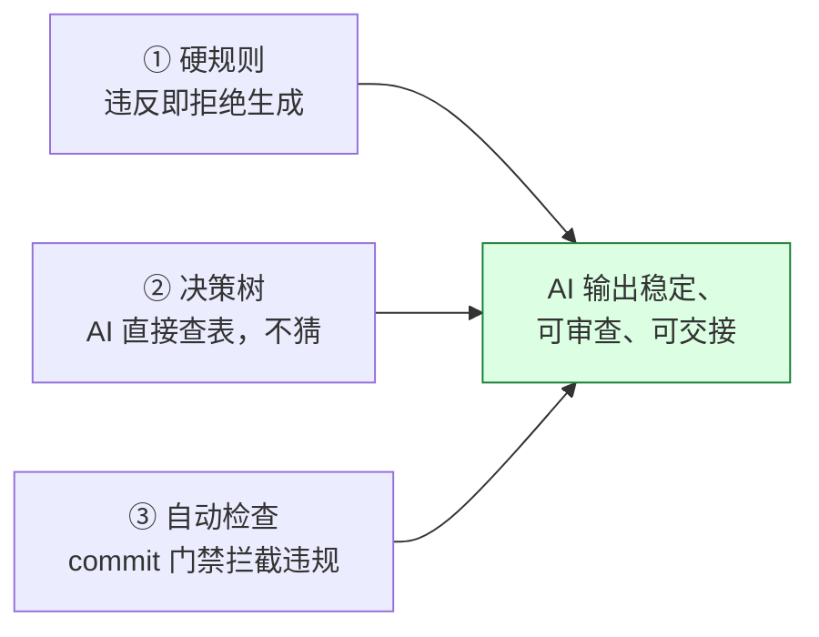

# AI 开发规范 × DDD Lite 架构方法论

一套让 AI 能稳定写出可维护、可交接、可落地的企业级 Java 后端的方法论。单体优先（Modular Monolith）、与微服务正交、开箱即用。

<p align="center">
  <a href="https://github.com/dayaoakng/AI-Native-JAVA/actions"></a>
  <a href="LICENSE"></a>
  <a href="#"></a>
  <a href="#"></a>
  <a href="#"></a>
  <a href="#"></a>
  <a href="#"></a>
  <a href="#"></a>
  <a href="#"></a>
</p>

---

## 目录

- [快速开始](#快速开始)
- [一句话看懂](#一句话看懂)
- [架构总览](#架构总览)
- [方法论：三件套](#方法论三件套)
- [三个关键数字](#三个关键数字)
- [文档导航](#文档导航)
- [贡献](#贡献)

---

## 快速开始

两个分支，按你的 JDK 环境选一个：

| 分支 | JDK | 说明 |
|------|-----|------|
| [`main`](https://github.com/dayaoakng/-AI-Native-JAVA/tree/main) | **JDK 8** | 与生产系统 BOSS 完全对齐，开箱可启动（H2 / MySQL） |
| [`jdk17`](https://github.com/dayaoakng/-AI-Native-JAVA/tree/jdk17) | **JDK 17** | 同 main，JDK 版本不同，CI 自动适配 |

```bash
# 克隆（默认 main 分支，JDK 8）
git clone https://github.com/dayaoakng/-AI-Native-JAVA.git

# 或直接拿 JDK 17 分支
git clone -b jdk17 https://github.com/dayaoakng/-AI-Native-JAVA.git

# 编译 + 测试（两个分支通用，scaffold 目录下）
cd -AI-Native-JAVA/scaffold
mvn test

# 启动服务（两个分支都支持，内置 H2 内存库，无需装数据库）
cd demo-modules/demo-partner
mvn spring-boot:run

# 验证接口
curl -X POST http://localhost:8080/partners \
  -H "Content-Type: application/json" \
  -d '{"code":"P001","name":"测试伙伴"}'
# → {"code":"200","data":{"id":1,"status":0,"statusDesc":"未激活"},...}
```

> 完整启动方式、连本地 MySQL 的方法见 [scaffold/README.md](scaffold/README.md)。

---

## 一句话看懂

> 传统开发：人写代码，AI 打辅助。  
> 我们的做法：**AI 按规范写代码，人做审查与决策**——因为规则足够明确，AI 的输出才能被信任。

## 架构总览

我们采用 **DDD Lite**：一个**单体优先（Modular Monolith）**的模块化架构，保留 DDD 的核心价值（充血模型、分层、领域边界），砍掉让 AI 和人都犯迷糊的抽象（聚合根直接用 `Entity`，不造 `Aggregate`）。**与微服务正交**——它管"一个进程内代码怎么写"，可嵌套进任意架构组合。



**依赖方向单一**：外层依赖内层，内层不依赖外层；domain 层不碰 Spring/MyBatis/Redis，可移植、可独立测试。

## 方法论：三件套

让 AI 输出可控，靠的不是「讲道理」，而是三件可执行的东西：



| 三件套 | 例子 |
|--------|------|
| **① 硬规则** | 禁止 `service/`；文件 ≤ 300 行、Handler ≤ 100 行、方法 ≤ 30 行；实体必须进 `domain/entity/` |
| **② 决策树** | 「这段代码是领域规则？→ 写 Entity；是用例编排？→ 写 Handler；是持久化？→ 写 infrastructure」 |
| **③ 自动检查** | 合规扫描 `scripts/standards/scan-compliance.py` 一键出报告；pre-commit hook（`.githooks/`）+ GitHub Action（`.github/workflows/ci.yml`）双门禁拦截违规 |

## 三个关键数字

| 指标 | 本仓库 scaffold 实测 | 生产系统（BOSS） |
|------|---------------------|-----------------|
| 业务模块 Handler | 2 个 | **462 个** |
| 假 Handler / 遗留 Service / DomainService / Aggregate | **0** | **全部为 0** |
| Controller 直调 Handler | **100%**（1/1） | **近 100%** |

> 口径可复算：`python scripts/standards/metrics.py --root scaffold`（对任何 DDD Lite 仓库都能跑出一份同样口径的报告）。
> 生产系统（BOSS）数据为内部实测，其源码未开源；本仓库以 `scaffold/` 作为最小可复现样本。

## 文档导航

| 文档 | 内容 | 读者 |
|------|------|------|
| [AI 开发手册](docs/AI开发手册.md) | **通用开发规范实操版**：分层、命名、职责边界、质量门禁、事件驱动、审查清单 | 开发者 / AI 助手 |
| [AI 开发规范方法论](docs/AI开发规范方法论.md) | 为什么 AI 写不好代码、我们的解法是什么 | 决策者 / 推广对象 |
| [架构说明](docs/架构说明.md) | DDD Lite 是什么、vs 传统 MVC / 经典 DDD、优缺点、与微服务如何组合 | 决策者 / 开发者 |
| [README (English)](README.en.md) | 本 README 的英文版 | 海外开发者 |
| [scaffold/](scaffold/) | 可直接运行的最小骨架（`mvn spring-boot:run` 一键启动，H2/MySQL 双库，7 个 Spock 测试通过） | 开发者 |
| [scaffold/README.md](scaffold/README.md) | 启动方式、连 MySQL、新建业务模块的完整步骤 | 开发者 |
| [AGENTS.md](AGENTS.md) | 喂给 AI 编程助手的规则入口（Claude Code / Cursor 通用） | AI 助手 |

> **文档关系**：[AI 开发手册](docs/AI开发手册.md) 是「怎么做」（实操规范），[AI 开发规范方法论](docs/AI开发规范方法论.md) 是「为什么」（价值与方法论），[架构说明](docs/架构说明.md) 是「对比与边界」（vs 传统 MVC / 经典 DDD，以及和微服务的关系）。

---

## 贡献

欢迎提 Issue 与 PR，详见 [CONTRIBUTING.md](CONTRIBUTING.md)；行为规范见 [CODE_OF_CONDUCT.md](CODE_OF_CONDUCT.md)；变更记录见 [CHANGELOG.md](CHANGELOG.md)。

---

**License**：[MIT](LICENSE) · 一份被生产系统验证过的 AI 开发范式。
