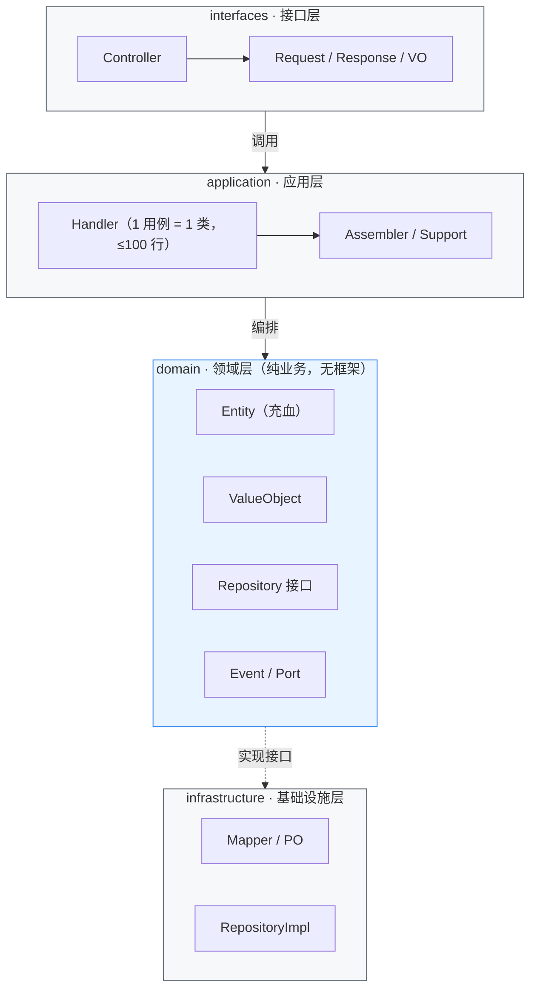
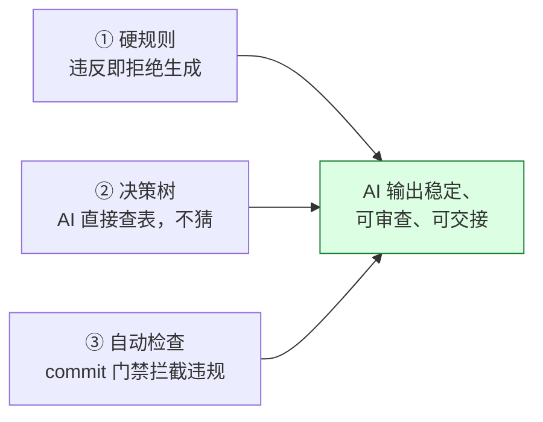

# AI 开发规范 × DDD Lite 架构方法论

一套让 AI 能稳定写出可维护、可交接、可落地的企业级 Java 后端的方法论。

  
  
  
  
  
  
  

---

## 目录

- [一句话看懂](#一句话看懂)
- [架构总览](#架构总览)
- [方法论：三件套](#方法论三件套)
- [三个关键数字](#三个关键数字)
- [文档导航](#文档导航)

---

## 一句话看懂

> 传统开发：人写代码，AI 打辅助。  
> 我们的做法：**AI 按规范写代码，人做审查与决策**——因为规则足够明确，AI 的输出才能被信任。

## 架构总览

我们采用 **DDD Lite**：保留 DDD 的核心价值（充血模型、分层、领域边界），砍掉让 AI 和人都犯迷糊的抽象（聚合根直接用 `Entity`，不造 `Aggregate`）。

**依赖方向单一**：外层依赖内层，内层不依赖外层；domain 层不碰 Spring/MyBatis/Redis，可移植、可独立测试。

## 方法论：三件套

让 AI 输出可控，靠的不是「讲道理」，而是三件可执行的东西：

| 三件套 | 例子 |
|--------|------|
| **① 硬规则** | 禁止 `service/`；文件 ≤ 300 行、Handler ≤ 100 行、方法 ≤ 30 行；实体必须进 `domain/entity/` |
| **② 决策树** | 「这段代码是领域规则？→ 写 Entity；是用例编排？→ 写 Handler；是持久化？→ 写 infrastructure」 |
| **③ 自动检查** | 合规扫描 `scripts/standards/scan-compliance.py` 一键出报告；pre-commit hook（`.githooks/`）+ GitHub Action（`.github/workflows/ci.yml`）双门禁拦截违规 |

## 三个关键数字（来自生产系统实测）

| 指标 | 数值 | 说明 |
|------|------|------|
| 业务模块 Handler | **462 个** | 1 用例 = 1 Handler，全程可追踪 |
| 假 Handler / 遗留 Service / DomainService / Aggregate | **全部为 0** | 反模式被规则彻底挡住 |
| Controller 直调 Handler（口径 A） | **近 100%** | 没有「假分层」，每一层都真的在工作 |

## 文档导航

| 文档 | 内容 | 读者 |
|------|------|------|
| [AI 开发手册](docs/AI开发手册.md) | **通用开发规范实操版**：分层、命名、职责边界、质量门禁、事件驱动、审查清单 | 开发者 / AI 助手 |
| [AI 开发规范方法论](docs/AI开发规范方法论.md) | 为什么 AI 写不好代码、我们的解法是什么 | 决策者 / 推广对象 |
| [架构优势](docs/架构优势.md) | DDD Lite 架构的设计与真实收益 | 决策者 / 推广对象 |
| [scaffold/](scaffold/) | 可直接运行的最小骨架（`mvn spring-boot:run` 一键启动，7 个 Spock 测试通过，含事件示例） | 开发者 |
| [AGENTS.md](AGENTS.md) | 喂给 AI 编程助手的规则入口（Claude Code / Cursor 通用） | AI 助手 |

> **文档关系**：[AI 开发手册](docs/AI开发手册.md) 是「怎么做」（实操规范），[AI 开发规范方法论](docs/AI开发规范方法论.md) 是「为什么」（价值与方法论），[架构优势](docs/架构优势.md) 是「结果」（真实成效）。

---

**License**：[MIT](LICENSE) · 一份被生产系统验证过的 AI 开发范式。
